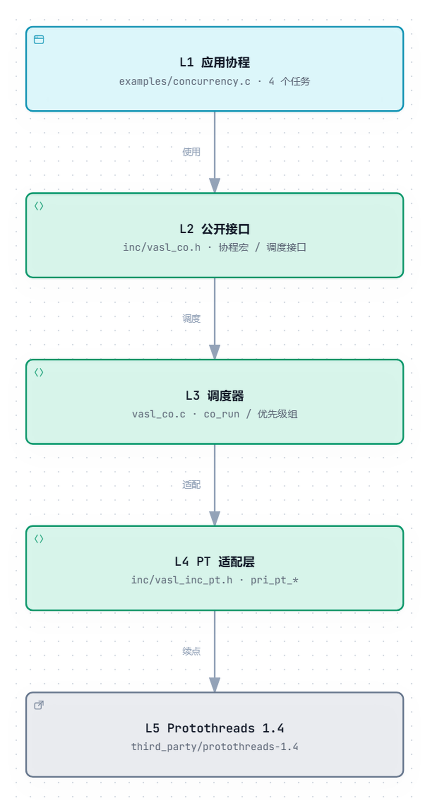

# vasl_co

`vasl_co` 是一个面向嵌入式单片机的无栈协程库。它把 Protothreads 的续点机制封装成一组可直接使用的协程原语，并提供按优先级调度的协作式调度器。

库本身不分配堆内存，不创建线程，也不切换栈。一个协程只保存自己的续点；任务控制块、调度表和信号量都可以静态分配。

## 特性

- 无栈：每个协程只保存一个续点，RAM 开销与任务栈无关。
- 无堆：不调用 `malloc/free`，所有对象由调用者静态定义。
- C99：核心只依赖 `<stdbool.h>`、`<stddef.h>`、`<stdint.h>`。
- 协程原语：让出、等待条件、延时、周期、超时等待、信号量。
- 调度器：静态任务表、3 个优先级（可配置）、协作式轮转。
- 句柄带序号：任务槽位复用后，旧句柄不会误删新任务。
- 可裁剪：时间、主调度器、调试输出均可通过宏关闭。

分层与单向依赖：[交互图](docs/architecture.html) · [静态预览](docs/architecture.png)

## 目录

```text
.
├── inc/
│   ├── vasl_co.h             核心 API
│   ├── vasl_co_api.h         简短别名层（可选）
│   ├── vasl_co_config.h      编译期配置
│   └── vasl_inc_pt.h         Protothreads 适配层
├── third_party/
│   └── protothreads-1.4/     Protothreads 1.4（BSD-style）
├── examples/
│   ├── blink.c               最小可运行示例
│   └── concurrency.c         多任务并发示例
├── vasl_co.c                 调度器与调试钩子实现
├── CMakeLists.txt
├── LICENSE                   MIT
└── THIRD_PARTY_NOTICES.md
```

## 分层结构

<p align="center">
  
</p>

依赖只有一条方向：应用协程 → 公开接口 → 调度器 → PT 适配层 → Protothreads。
业务代码只包含 `vasl_co.h`，不直接写 PT 宏；Protothreads 只作为最底层的续点机制。

交互版：[`docs/architecture.html`](docs/architecture.html)

推送到 GitHub 后，`.github/workflows/pages.yml` 会把 `docs/` 发布为 Pages；
首次运行会尝试自动启用 Pages（若仓库策略允许）。

## 快速开始

先提供一个毫秒时基。裸机上通常放在 SysTick 中断里递增：

```c
#include <stdint.h>
#include "vasl_co.h"

static volatile uint32_t g_ms;

uint32_t vasl_get_tick_ms(void)
{
    return g_ms;
}

/* SysTick 中断中调用 */
void systick_handler(void)
{
    ++g_ms;
}
```

一个每 500 ms 翻转 LED 的协程：

```c
#include "vasl_co.h"

static void led_toggle(void);

static int blink(void *arg)
{
    vasl_co_setup_arg(arg);

    vasl_co_begin();
    for (;;) {
        vasl_co_period_ms(500U);
        led_toggle();
    }
    vasl_co_end;
}
```

启动调度器：

```c
VASL_CO_CREATE_SCHE(sch, 1U);

int main(void)
{
    vasl_co_task_handle_t h;
    int rc;

    rc = vasl_coops.add_group(&sch, 0U, NULL);
    if (rc != VASL_CO_ERR__OK && rc != VASL_CO_ERR__SCH_PRI_REPLACED) {
        return -1;
    }

    if (vasl_coops.add(&sch, blink, NULL, &h) != VASL_CO_ERR__OK) {
        return -1;
    }

    for (;;) {
        vasl_coops.run(false);
    }
}
```

`vasl_co_begin()` 后面直接写 `for (;;)`、`while (...)` 或普通 `{ ... }`，由 `vasl_co_end;` 收尾。不要把 `vasl_co_begin()` 单独写成一条以分号结束的语句，例如：

```c
vasl_co_begin();          /* 不要这样写 */
do_work();
vasl_co_end;
```

这种写法会把后面的代码排除在协程块之外，行为不符合预期。正确形式是 `vasl_co_begin(); for (;;) { ... } vasl_co_end;`。

## 多任务并发示例

`examples/concurrency.c` 展示四个协程在同一个线程里协作运行：

- `alarm`（优先级 0）等待按键，1 s 无事件时打印 idle；
- `sensor`（优先级 1）每 500 ms 采样，并 post 信号量；
- `console`（优先级 2）等待信号量，200 ms 超时；
- `blink`（优先级 2）每 300 ms 翻转 LED。

关键片段：

```c
static int sensor_task(void *arg)
{
    vasl_co_setup_arg(arg);

    vasl_co_begin();
    for (;;) {
        vasl_co_period_ms(500U);

        ++g_samples;
        printf("sample #%u\n", g_samples);
        vasl_co_sem_post(g_sample_sem);

        if (g_samples >= 5U) {
            vasl_co_exit;
        }
    }
    vasl_co_end;
}

static int console_task(void *arg)
{
    vasl_co_setup_arg(arg);

    vasl_co_begin();
    for (;;) {
        g_console_timeout = 0;
        vasl_co_sem_wait_timeout_ms(g_sample_sem, 200U, {
            g_console_timeout = 1;
        });

        if (g_console_timeout) {
            puts("wait sample timeout");
        } else {
            printf("consume sample #%u\n", g_samples);
        }

        if (g_samples >= 5U) {
            vasl_co_exit;
        }
    }
    vasl_co_end;
}
```

启动时用三个调度器分别挂到 0/1/2 优先级：

```c
VASL_CO_CREATE_SCHE(sch_high, 1U);
VASL_CO_CREATE_SCHE(sch_mid, 1U);
VASL_CO_CREATE_SCHE(sch_low, 2U);

vasl_coops.add_group(&sch_high, 0U, NULL);
vasl_coops.add_group(&sch_mid, 1U, NULL);
vasl_coops.add_group(&sch_low, 2U, NULL);
```

实际运行会交错输出：高优先级 alarm 先响应按键；sensor 每 500 ms 产生样本；console 在没样本时按 200 ms 超时；blink 独立翻转。它们不是抢占式线程，而是在 `wait/period` 处主动让出，所以所有共享变量仍然只在同一个执行流里访问。

节选：

```text
[  200 ms] console: wait sample timeout
[  300 ms] blink  : LED ON
[  500 ms] sensor : sample #1, 24.5 C
[  500 ms] console: consume sample #1
[  900 ms] main   : button pressed
[  900 ms] alarm  : button -> buzzer 80 ms
[ 1900 ms] alarm  : 1 s idle, keep watching
[ 2500 ms] sensor : 5 samples done, exit
```

运行：

```sh
./build/vasl_co_concurrency
```


## 编译

使用 CMake：

```sh
cmake -S . -B build
cmake --build build
./build/vasl_co_blink
```

也可以直接编译：

```sh
gcc -std=gnu99 -Wall -Wextra \
    -Iinc -Ithird_party \
    examples/blink.c vasl_co.c -o blink
```

GCC 的 label 扩展是默认路径。若工具链不支持 label 扩展，或需要严格 C99，使用 switch 版本：

```sh
gcc -std=c99 -DVASL_CO_USE_SWITCH=1 ...
```

## API 一览

### 协程

| API | 说明 |
| --- | --- |
| `vasl_co_setup_arg(arg)` | 从任务参数中取出协程上下文，放在函数开头 |
| `vasl_co_begin()` | 协程入口，后接循环或块 |
| `vasl_co_end` | 协程出口，带分号 |
| `vasl_co_yield` | 让出一次 |
| `vasl_co_yield_until(cond)` | 条件为真后继续 |
| `vasl_co_wait(cond)` | 等待条件为真 |
| `vasl_co_wait_while(cond)` | 条件为假后继续 |
| `vasl_co_exit` | 结束协程 |
| `vasl_co_restart` | 重置续点，下次从头执行 |

### 时间

需要 `VASL_CO_TIME_USE_BASE_MS=1`，并提供 `vasl_get_tick_ms()`。

| API | 说明 |
| --- | --- |
| `vasl_co_delay_ms(ms)` | 延时 |
| `vasl_co_period_ms(ms)` | 周期唤醒 |
| `vasl_co_yield_until_timeout(cond, ms, on_timeout)` | 条件等待，超时执行 `on_timeout` |
| `vasl_co_wait_timeout_ms(cond, ms, on_timeout)` | 等待条件，超时执行 `on_timeout` |
| `vasl_co_sem_wait_timeout_ms(sem, ms, on_timeout)` | 信号量等待，超时分支不消耗信号量 |

`on_timeout` 是语句块，例如：

```c
vasl_co_wait_timeout_ms(flag, 100U, {
    timeout_count++;
});
```

### 信号量

```c
vasl_co_sem_t sem;

vasl_co_sem_init(sem, 1U);
vasl_co_sem_wait(sem);
vasl_co_sem_post(sem);
```

### 调度器

| API | 说明 |
| --- | --- |
| `VASL_CO_CREATE_SCHE(name, capa)` | 静态定义调度器和任务表 |
| `vasl_coops.add_group(sch, prio, old)` | 把调度器挂到优先级组 |
| `vasl_coops.add(sch, func, arg, handle)` | 加入任务 |
| `vasl_coops.remove(handle)` | 移除任务 |
| `vasl_coops.run(use_dbg)` | 轮转一次所有已挂载的调度器 |

`add_group()` 在成功替换空槽位时返回 `VASL_CO_ERR__SCH_PRI_REPLACED`，这是该 API 的历史返回值，不代表失败。未调用 `add_group()` 的调度器不会被执行。

`run()` 会遍历所有已注册调度器；当任务返回 `VASL_CO_RET__YIELDED` 时也会被标记为 busy。调度器不会抢占，任务必须主动让出。

## 配置

在 `inc/vasl_co_config.h` 中修改，或在编译命令行覆盖：

| 宏 | 默认 | 说明 |
| --- | --- | --- |
| `VASL_CO_USE_SWITCH` | `0` | `0` 用 GCC label；`1` 用 switch |
| `VASL_CO_GROUP_PRIORITY_MAX` | `3` | 优先级组数，0 最高 |
| `VASL_CO_TIME_USE_BASE_MS` | `1` | 启用毫秒时基 |
| `VASL_CO_TASK_USE_MAIN` | `1` | 生成 `MainSche` |
| `VASL_CO_TASK_MAIN_MAX_TASKS` | `10` | `MainSche` 容量 |
| `VASL_CO_USE_DBG` | `1` | 启用调试输出钩子 |

关闭调试：

```sh
-DVASL_CO_USE_DBG=0
```

## 与 FreeRTOS 的关系

`vasl_co` 不替代 FreeRTOS，二者解决的是不同层次的问题：

- FreeRTOS 任务有独立栈，可抢占，适合阻塞调用和驱动隔离；每个任务通常要 1–4 KB 栈。
- `vasl_co` 协程没有独立栈，只在续点处切换，适合大量小状态机、协议解析、按键扫描、LED 呼吸等轻量逻辑。
- 在已经使用 FreeRTOS 的系统中，可以把多个协程放进一个 FreeRTOS 任务里运行，用协程消除大量小任务和忙等状态机；需要阻塞驱动时仍交给 FreeRTOS 任务或中断。

因此，即使项目已经使用 FreeRTOS，也可以把 `vasl_co` 作为任务内部的轻量协作层。

## 可移植性

需要 C99 编译器。默认路径使用 GCC/Clang 的 label 扩展；IAR、Keil 等不支持该扩展的工具链请设置 `VASL_CO_USE_SWITCH=1`。

库不包含启动文件、时钟初始化或 `printf` 重定向。移植时只需提供：

- `vasl_get_tick_ms()`：毫秒计数；
- 或关闭时基并自行管理时间；
- 可选的 `VASL_CO_DBG_FUNC`：调试输出函数。

## 许可

本仓库代码使用 MIT License，见 `LICENSE`。

`third_party/protothreads-1.4/` 来自 Adam Dunkels 的 Protothreads 1.4，使用 BSD-style 许可，需保留 credit。详见 `THIRD_PARTY_NOTICES.md` 与该目录下的 `README`。
